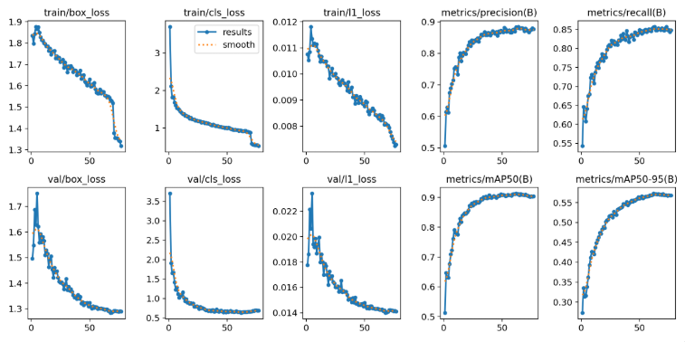

# 🛡️ AI_yolov26 - Hệ Thống Phát Hiện Vi Phạm Bảo Hộ Lao Động (Mũ & Vest)

> **Version 1.0** | Hệ thống giám sát an toàn lao động thời gian thực sử dụng AI (YOLO), kết hợp giao diện Web quản lý vi phạm và tự động đẩy cảnh báo qua Telegram Bot.

---

## 📺 Project Demo
👉 [Click here to watch the system demo on Google Drive](https://drive.google.com/file/d/11DhyZULTP6giOeTa3UVSx5LweRJKTA_G/view?usp=sharing)

## 📊 Dataset & Training Results

### 1. Dataset Instance Distribution
The model was trained on a consolidated dataset of 4,000 curated construction site images with targeted augmentations:

| Class Name | Training Instances | Validation Instances |
| :--- | :---: | :---: |
| 👤 **Class 0 (Head)** | 24,577 | 4,781 |
| 🪖 **Class 1 (Helmet)** | 8,897 | 2,225 |
| 🦺 **Class 2 (Vest)** | 3,488 | 863 |
| ❌ **Class 3 (No-vest)** | 8,066 | 2,166 |
| **Total** | **45,028** | **10,035** |

### 2. Model Performance Metrics
Detailed training curves and verification metrics are stored in the `Training_result/` directory.
- **Peak mAP50:** `91.37%` (Achieved at Epoch 62)
- **Peak Precision:** `88.48%` (Achieved at Epoch 64)
- **Peak Recall:** `85.74%` (Achieved at Epoch 73)
- **mAP50-95:** `57.30%`



## 📌 Tính Năng Chính
- **Quét Camera Live (Real-time):** Hỗ trợ kết nối qua Webcam máy tính hoặc luồng **RTSP** từ Camera IP / Ứng dụng điện thoại (như *OctoStream*).
- **Phát hiện vi phạm:** Tự động quét và nhận diện người không đội mũ bảo hộ / không mặc áo vest.
- **Cảnh báo Telegram:** Tự động gửi tin nhắn kèm hình ảnh vi phạm trực tiếp về Telegram cá nhân/nhóm.
- **Quản lý dữ liệu trên Web:**
  - Hiển thị luồng video live tích hợp bounding box AI.
  - Xem danh sách và kiểm tra ảnh các trường hợp vi phạm.
  - Tương tác kiểm tra xem ảnh vi phạm này **đã được duyệt hay chưa**.
  - Quản lý bộ nhớ: **Làm mới file lưu**, **xóa ảnh vi phạm thừa**.

---

## ⚙️ Cấu Hình File `.env` (Telegram Bot)

### Bước 1: Lấy Token & Chat ID
1. **Lấy Bot Token:** Chat với `@BotFather` trên Telegram -> gõ `/start` -> `/newbot` -> đặt tên hiển thị -> đặt tên username (viết liền không dấu, có đuôi `_bot`, ví dụ: `safety_alert_v1_bot`) -> copy chuỗi Token.
2. **Lấy Chat ID:** Chat với `@userinfobot` -> gõ `/start` -> copy chuỗi ID bản thân.

### Bước 2: Dán thông tin vào file `.env`
*(Nếu không mở trực tiếp được file `.env`, đổi tên thành `.env.txt` $\rightarrow$ sửa xong $\rightarrow$ đổi tên lại thành `.env`)*

Điền 2 ID vừa lấy vào file `.env` theo định dạng:
```env
TELEGRAM_BOT_TOKEN=858439xxx5:AAH9ZaGOHxQrrlEJSb-vuSBb...
TELEGRAM_CHAT_ID=xxxxxxxxxx
```

---

## 🚀 Hướng Dẫn Cài Đặt & Chạy Dự Án

Mở Terminal tại thư mục gốc `AI_yolov26` và chạy lần lượt các lệnh sau:

### 1. Kích hoạt môi trường & Cài đặt thư viện
```bash
# Tạo môi trường ảo venv (nếu chưa có)
python -m venv venv

# Kích hoạt venv (Windows PowerShell)
.\venv\Scripts\activate

# Cài đặt toàn bộ thư viện phụ thuộc
pip install -r requirements.txt
```

### 2. Khởi chạy Server Web
```bash
python app.py
```
> **Đường dẫn truy cập:** Copy `http://127.0.0.1:5000/` từ Terminal dán vào trình duyệt web (Chrome/Edge) để sử dụng.

---

## 📹 Hướng Dẫn Sử Dụng Chi Tiết

### A. Mở Camera & Kết Nối Quét Dữ Liệu
1. Mở trang web lên.
2. Lựa chọn phương thức kết nối Camera:
   - **Mở Webcam:** Bật trực tiếp camera gắn trên máy tính.
   - **Kết nối RTSP:** Tải ứng dụng **OctoStream** trên điện thoại -> lấy đường dẫn RTSP phát từ ứng dụng -> dán đường dẫn RTSP vào giao diện web để kết nối camera.
3. Hệ thống sẽ tự động bật camera, thực hiện quét live thời gian thực và hiển thị luồng dữ liệu lên trang web.
4. Khi phát hiện vi phạm (không mũ/vest), hệ thống tự động ghi nhận check log và đẩy ngay thông báo đính kèm ảnh về **Telegram**.

### B. Tương Tác & Quản Lý Dữ Liệu Trên Web
* **Check Log & Duyệt Vi Phạm:** Mở danh sách log vi phạm để xem ảnh chụp. Kiểm tra và cập nhật trạng thái xem ảnh vi phạm này **đã được duyệt hay chưa**.
* **Làm Mới File Lưu:** Sử dụng chức năng **Làm mới file lưu** để cập nhật danh sách dữ liệu mới nhất.
* **Xóa Ảnh Vi Phạm Thừa:** Chọn tính năng xóa bớt các ảnh vi phạm thừa không cần thiết để dọn dẹp dung lượng lưu trữ.

---

## 📁 Cấu Trúc Thư Mục Dự Án

```text
AI_yolov26/
│
├── .env                    # File chứa Token Telegram & ID cấu hình
├── app.py                  # File chính khởi chạy Web Server (Flask)
├── detector_worker.py      # Tiến trình phụ xử lý quét AI & gửi Telegram
├── best_yolov26.pt         # File Weights mô hình YOLO
├── best_yolov26_new.pt     # File Weights mô hình YOLO (bản cập nhật)
├── detections.db           # Cơ sở dữ liệu SQLite lưu vết vi phạm
├── requirements.txt        # Danh sách thư viện phụ thuộc
├── static/                 # Tài nguyên tĩnh CSS, JS, hình ảnh
├── templates/              # Giao diện HTML của ứng dụng Web
├── uploads/                # Thư mục chứa dữ liệu tải lên
├── violations/             # Thư mục lưu trữ ảnh chụp vi phạm
└── README.md               # File hướng dẫn dự án
```
